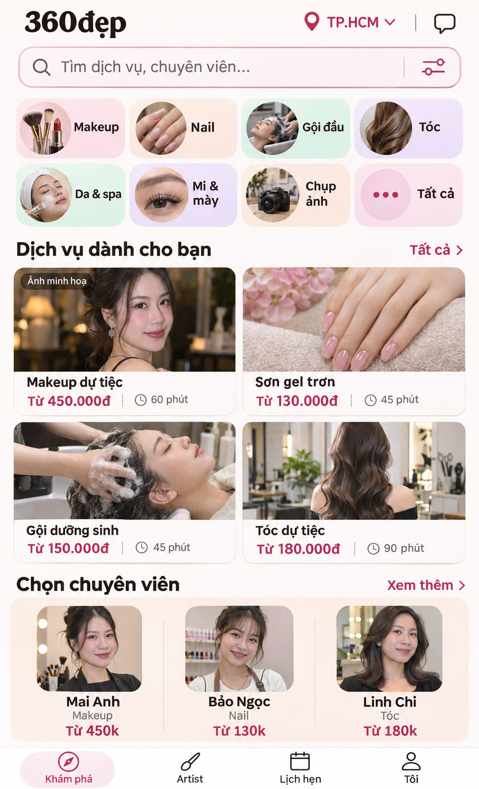
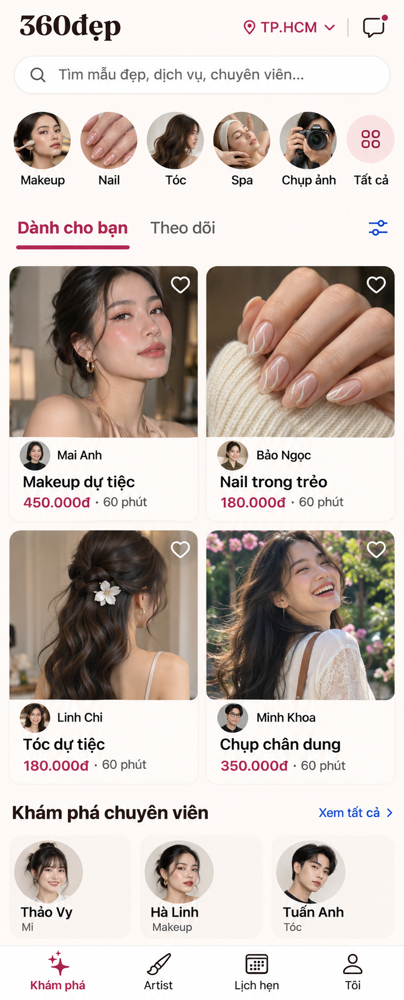
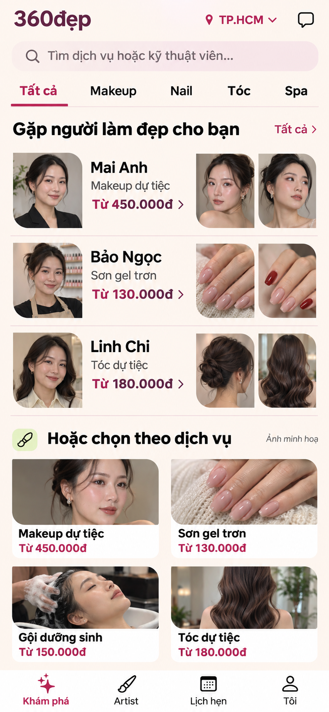

# Audit lại ref theo phản hồi về mật độ — 09/11/2026

## Điều chỉnh kết luận thiết kế

Phản hồi của chủ sản phẩm: ref trước thiếu sáng tạo, hiển thị quá ít sản phẩm/dịch vụ và kỹ thuật viên so với trải nghiệm cần có.

Phản hồi đúng. Lượt trước đã áp dụng quá mạnh hướng giản lược: bỏ các lựa chọn hữu ích thay vì giảm phần trang trí và quyết định thừa. Marketplace cần cho khách thấy chiều rộng danh mục, giá và người thực hiện để khám phá/so sánh. Chữ lớn không đòi hỏi mỗi màn chỉ có hai dịch vụ.

Giữ các phát hiện lỗi luồng/giá trong AUDIT.md, nhưng **không dùng ba ref v1 làm hướng triển khai**. Các ảnh v2 là vòng khám phá mới; chưa có ref được chốt, chưa sửa code.

## Audit ba ref v1

| Ảnh | Dịch vụ có tên và giá | Kỹ thuật viên có tên | Đánh giá |
|---|---:|---:|---|
| 01 | 2 | 0 | Slogan lớn, search và hai tab đẩy dịch vụ xuống thấp. Banner spa chung không tạo thêm lựa chọn cụ thể. |
| 02 | 2 | 0 | Hero đơn chiếm gần 1/3 màn; giống trang giới thiệu một phong cách hơn nơi so sánh nhiều dịch vụ và người làm. |
| 03 | 2 | 0 | Form khu vực/ngày đứng trước việc cho thấy nguồn cung; khách chưa biết có ai để chọn. Ảnh dự tiệc vẫn dùng trang phục cô dâu. |

Ba ảnh khác cách xếp nhưng lặp lại nền kem, tiêu đề lớn, hai dịch vụ, spa banner và thiếu người làm. Đây là thiếu khác biệt về trải nghiệm, không chỉ thiếu màu sắc.

## Nguyên tắc thay thế

1. Giảm slogan, banner chung, khoảng cách dư và card cơ chế đặt; giữ nhiều dịch vụ và người làm.
2. Mỗi ảnh phải giúp chọn: kết quả làm đẹp, người thực hiện hoặc nơi cung cấp. Không dùng ảnh lớn chỉ để trang trí.
3. Có hai đường khám phá thấy ngay: dịch vụ/giá và chuyên viên/tay nghề.
4. Ưu tiên tên + giá đúng dịch vụ + chuyên môn người làm. Không đưa giá nail thành giá makeup như lỗi đã tái hiện.
5. Nguyên tắc chữ: mục tiêu tên/giá 16–17pt, metadata 14–15pt và vùng bấm 44pt. Đây là yêu cầu khi triển khai, không thể xác nhận chỉ bằng ảnh raster.
6. Dữ liệu minh hoạ nhiều hồ sơ để thử mật độ thiết kế. Không coi đó là nguồn cung thật và không tạo hồ sơ/đánh giá giả trên app.

## Audit bộ v2 vừa gen

Thứ tự trùng với ba ảnh mới hiển thị trong chat. Tên, ảnh kỹ thuật viên và các giá trong ảnh là mock data.

| Ảnh v2 | Nội dung nhìn thấy trong toàn ảnh | Cách khám phá khác nhau |
|---|---|---|
| 01 | 8 danh mục, 4 dịch vụ có giá, 3 kỹ thuật viên có tên/chuyên môn/giá | Danh mục → dịch vụ; có hàng kỹ thuật viên riêng để chọn người |
| 02 | 4 tác phẩm gắn dịch vụ/giá/người làm; 3 hồ sơ phụ = 7 người có tên | Khám phá kết quả làm đẹp rồi mở người thực hiện hoặc dịch vụ ngay từ cùng thẻ |
| 03 | 3 kỹ thuật viên, mỗi người có chân dung, dịch vụ, giá và 2 ảnh tay nghề; thêm 4 dịch vụ | So sánh người và tay nghề trước; vẫn có đường vào theo dịch vụ |

### Độ vừa màn: chưa đánh đồng concept với layout đã kiểm chứng

| Ảnh | Kích thước raster | Chiều cao nếu hiển thị rộng 390 | Giới hạn |
|---|---|---:|---|
| 01 | 977×1610 | 643pt | Tỷ lệ rộng hơn brief; không kéo giãn ảnh để nhận là 390×844. Phải bố trí lại khoảng thở/cỡ chữ khi chốt. |
| 02 | 798×1972 | 964pt | Toàn ảnh dài hơn một màn 844pt. Rail 3 hồ sơ phụ phải xuống phần cuộn; không khẳng định cả 7 người cùng nằm trong màn đầu. |
| 03 | 853×1844 | 843pt | Gần đúng tỷ lệ mục tiêu; là bằng chứng bố cục tốt nhất cho mục tiêu 4 dịch vụ + 3 người trong một khung. Chưa tính safe areas/native text scaling. |

Không có ảnh nào chứng minh font, touch targets, accessibility hay scroll hoạt động. Chưa chấp thuận code.

### Các điểm còn phải tinh chỉnh

- 01: tám category entrance hơi nặng và metadata có nguy cơ nhỏ khi quy về điện thoại; giảm kích thước khối danh mục trước khi giảm chữ.
- 02: tác phẩm và người làm đã gắn nhau rõ, nhưng ảnh còn lớn; khi chốt cần hạ chiều cao ảnh hoặc đẩy rail người phụ xuống dưới fold, giữ tab bar cố định. Không gắn nút lưu ở vị trí đè lên nội dung quan trọng của ảnh.
- 03: ba hồ sơ dễ so sánh hơn, nhưng thumbnail tác phẩm phải có nhãn/khả năng mở xem để khách phân biệt ảnh người làm với ảnh kết quả. Dịch vụ bên dưới lặp một số nội dung của hồ sơ, cần rank để tạo thêm lựa chọn thay vì chỉ lặp.
- Cả ba: cần chân dung và tác phẩm thật đa dạng khi có dữ liệu. Không dùng cùng một gương mặt stock để đại diện nhiều người. Ảnh minh hoạ và ảnh portfolio thật phải được phân biệt.
- Thông tin đặt còn thiếu: tại nhà/tại cơ sở, địa bàn và thời lượng chưa nhất quán. Ref 01 ghi Tóc dự tiệc 90 phút, ref 02 ghi 60 phút với cùng giá; cần một bộ mock data chung trước khi chốt để so bố cục công bằng.
- Nhãn người làm đang lẫn “kỹ thuật viên”, “chuyên viên” và tab “Artist”; phải chọn thuật ngữ thống nhất. Việc tăng số card không thay thế được thông tin giúp khách quyết định.
- Nguồn cung ít phải xử lý bằng trạng thái rõ ràng và khu vực phù hợp, không bịa số người/rating để tạo cảm giác đông.

## Ảnh để đối chiếu

### V2 — 01

### V2 — 02

### V2 — 03

Prompt đầy đủ được lưu cạnh mỗi PNG. [Audit app với 13 ảnh mới chụp](AUDIT.md) và [ref cũ đã bị bác](refs/README.md) vẫn được giữ để đối chiếu.
