# Audit UI/UX 360đẹp — 09/11/2026

## Kết luận

App có chữ khá dễ đọc và giá cố định ở cuối luồng đặt, nhưng thứ bậc nội dung chưa tốt: nhiều khối cùng tranh sự chú ý, khách phải hiểu cách vận hành trước khi chọn nhu cầu, và dữ liệu mỏng đang được lấp bằng ảnh minh hoạ. Đổi màu hoặc bo góc sẽ không giải quyết được các điểm này.

**Lỗi đáng ưu tiên nhất đã tái hiện:** lọc Artist theo Makeup nhưng giá vẫn là 130k của Sơn gel; makeup thực tế của người này là 450.000đ. **Ma sát lớn đã tái hiện:** chọn gói ở hồ sơ → “Chọn lịch” → “Chọn món” → “Giỏ của bạn” → mới được chọn giờ.

Chưa sửa code ứng dụng, chưa gửi lịch, chưa đăng nhập hay liên hệ đối tác. Chỉ thêm báo cáo, ảnh chụp và ảnh concept.

## Phạm vi và độ tin cậy

- Source: nhánh `feat/spa-venues`, commit `d308051`.
- Capture mới trong phiên này: native iOS đang cài trên simulator có sẵn, chạy JS hiện tại qua Metro; dữ liệu công khai của đúng project 360đẹp bằng publishable key, không dùng service role. Không khẳng định đây là binary App Store.
- Luồng khách vãng lai: Khám phá → Makeup → dịch vụ → hồ sơ → đặt lịch tới đăng nhập; thêm tìm tên, tab Artist, bộ lọc, kết quả sau lọc.
- 13 file gốc được giữ nguyên, gồm cả khung Simulator. Không dùng ảnh audit cũ để kết luận hiện trạng.
- Không có spa trong nguồn cung được hiển thị ở lần capture này. Spa, web, flow đối tác và các rủi ro chưa chạy có nhãn **source-only** trong tài liệu bổ sung.
- Chưa thử Android, máy thật, đăng nhập thành công, gửi/huỷ lịch thật, chat, thanh toán, VoiceOver/TalkBack, Dynamic Type lớn và trạng thái mạng yếu. Không kết luận tuân thủ accessibility toàn app.
- Đã dừng Metro và shutdown simulator sau capture; không tạo simulator, Docker stack hay worktree mới.

## Những điều cần giữ

- Chữ thân bài lớn, thông tin giá chính đọc tốt; không thu nhỏ chữ để nhét thêm nội dung.
- Chọn dịch vụ, xem giá và giờ trước khi bắt đăng nhập. Khi đóng login, bản nháp vẫn giữ ngày/giờ/gói đã chọn.
- Giá ở chân màn hình đặt lịch; trạng thái ngày/giờ được chọn rõ, lịch tách sáng/chiều/tối.
- Ảnh minh hoạ có nhãn, hồ sơ mới không bịa đánh giá hay số lịch hoàn thành.
- Bộ lọc có footer cố định và chip xoá từng điều kiện sau khi áp dụng.

## Ưu tiên thiết kế và lỗi luồng

| Mức | Vấn đề | Bằng chứng | Định hướng |
|---|---|---|---|
| P1 | Giá Artist không theo nhu cầu đang lọc | 04 có makeup 450.000đ; 13 lọc Makeup vẫn “Từ 130k” | Giá luôn đi kèm tên dịch vụ, đơn vị và số lượng tối thiểu; sort cùng một cơ sở giá |
| P1 | CTA hứa chọn lịch nhưng còn hai bước trung gian | 04 → 05 → 06 → 07 | Gói đã chọn chuyển thẳng sang ngày/giờ; thêm dịch vụ là hành động phụ |
| P1 | Dịch vụ có/không có người nhận trông gần như nhau | 01–02; AX báo thiếu người nhận ở nhiều danh mục, source phân biệt CatalogTile | Hiện trạng thái khả dụng ngay trên dịch vụ; không khiến “giá tham khảo” giống lời hứa có thể đặt |
| P2 | Phần đầu Home dùng nhiều diện tích cho cách đặt | 01 | Cho chọn nhu cầu trước, giảm hai thẻ cơ chế thành lựa chọn nhỏ ở bước phù hợp |
| P2 | Ảnh và chức năng chưa cùng một câu chuyện | 01–03: ảnh cô dâu cho dự tiệc, ảnh nhiều người ở dịch vụ một người, một card ảnh cạnh một card icon | Chọn ảnh đúng gói, crop và ánh sáng đồng nhất; nhãn minh hoạ rõ nhưng nhẹ |
| P2 | Hồng + be + nhiều thẻ trắng và pill tạo cảm giác ghép nhiều lớp | 01–09 | Dùng một nền sáng chủ đạo, giảm khối hồng lớn, ít border, rose dành cho hành động chính |
| P2 | Hồ sơ mới chưa đủ bằng chứng để khách chọn | 04: logo mặc định, 0 lịch, chưa đánh giá, chưa tác phẩm | Gói và phạm vi phục vụ lên trước; gộp trạng thái mới thành một câu trung thực, không dựng social proof |
| P2 | Nội dung chi tiết bị ảnh minh hoạ quá cao đẩy xuống | 03 | Ảnh ngắn hơn, giá/gói/người làm/CTA trong lượt nhìn đầu; gallery mở rộng theo yêu cầu |
| P2 | Trang xác nhận lặp giá và dồn chính sách thành đoạn dài | 08 | Tóm tắt rõ dịch vụ, ngày giờ, địa chỉ, phí; tách câu cần biết, phần chi tiết mở rộng |
| P2 | Login dài và copy chưa đồng nhất | 09: Apple tiếng Anh, separator “email” nhưng field nhận cả SĐT | Giảm đoạn mở đầu, nhắc lợi ích quay lại đơn đang đặt, dùng nhãn nhất quán |
| P2 | Bộ lọc dài trước khi đến nơi phục vụ | 12 | Ưu tiên dịch vụ, địa điểm, giá; nhóm ngành ít dùng để mở rộng, giữ footer hiện có |
| P2 | Các rủi ro accessibility chưa được chạy | NATIVE-SOURCE/WEB-SOURCE | Kiểm tra chữ lớn, focus, thông báo lỗi và target nhỏ sau khi chọn ref |

## 13 bước và ảnh bằng chứng

### 01 — Khám phá: cần thiết kế lại thứ bậc

Header hồng, vòng danh mục nhiều màu, hai card cách đặt và lưới dịch vụ đều có độ nổi bật tương tự. Tên/giá dịch vụ đầu tiên chưa nằm trọn trong lượt nhìn đầu. Thanh tab kính chồng lên vùng ảnh đang cuộn làm phần đáy bận mắt. Dùng nhu cầu của khách làm điểm bắt đầu; giữ địa điểm và search gọn.

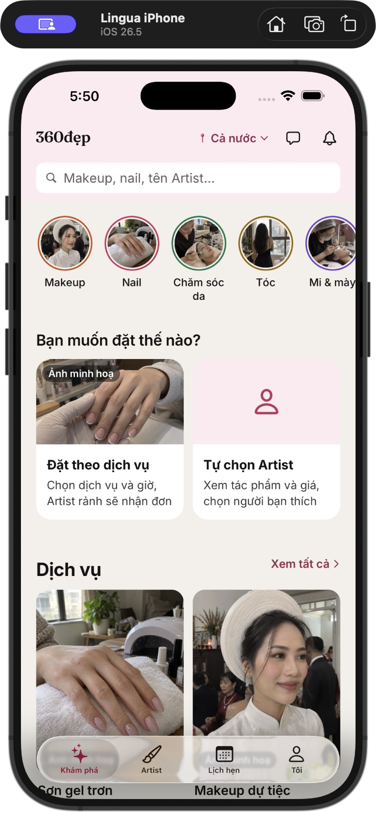

### 02 — Danh sách Makeup: dùng được, thiếu phân biệt khả dụng

Chữ và giá đọc được nhưng ảnh cao, hai hàng chip chiếm nhiều chiều cao. Makeup có người nhận hiện tên Nguyễn Thy; các gói chỉ thuộc catalog vẫn có ảnh và giá tương tự, không nói rõ cần chờ nguồn cung. Giá theo người ở gói nhóm cần thêm tổng tối thiểu ngay tại nơi so sánh.

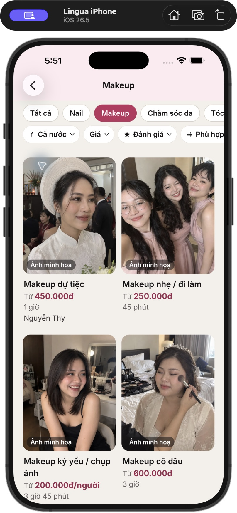

### 03 — Chi tiết dịch vụ: điểm quyết định bị đẩy xuống

Gallery ảnh minh hoạ chiếm gần nửa nội dung màn hình. Sau ảnh lại hỏi cách đặt; danh sách người thực hiện nằm phía dưới. Khách đã chọn nhu cầu nhưng vẫn phải quyết định mô hình nhận đơn. Giảm gallery mặc định và đặt gói + giá + người làm gần nhau.

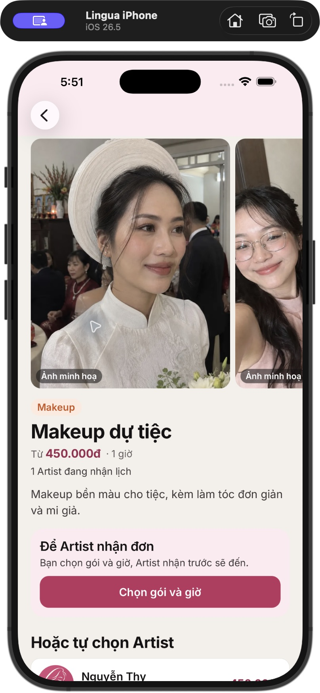

### 04 — Hồ sơ Artist: thiếu bằng chứng tin cậy, lặp giá

Hồ sơ quan sát được chưa có tác phẩm hay đánh giá; logo mặc định lặp thương hiệu app. Khối ba cột 0/Mới/— chiếm diện tích dù không thêm thông tin giúp chọn. Gói được chọn có nền hồng, viền hồng, ô giá hồng và giá ở footer cùng lúc. Cần tiết chế và ưu tiên dữ kiện có thật.

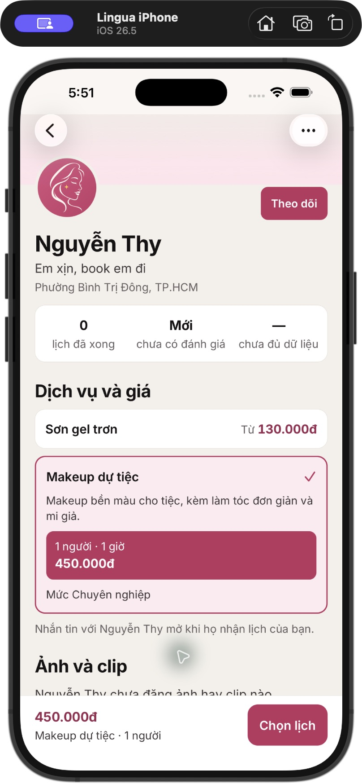

### 05 — Chọn dịch vụ trong booking: bước thừa với gói đã chọn

Đã chọn Makeup dự tiệc 450.000đ tại hồ sơ, bấm “Chọn lịch” vẫn vào “Chọn món” 1/4. Từ “món” giống đặt đồ ăn hơn dịch vụ làm đẹp. Có thể cho thêm nhiều dịch vụ mà không buộc mọi đơn một dịch vụ qua màn này.

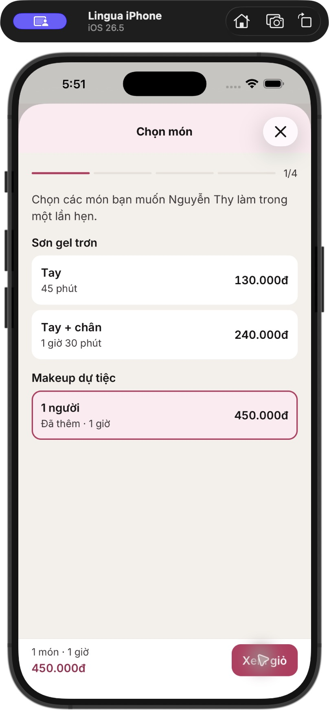

### 06 — Giỏ: bước xác nhận lại ít giá trị

Một dịch vụ được trình bày lại, phần lớn màn hình để trống, nút chính chỉ đưa tới chọn giờ. Gộp tóm tắt này vào ngày/giờ với một liên kết sửa hoặc thêm dịch vụ.

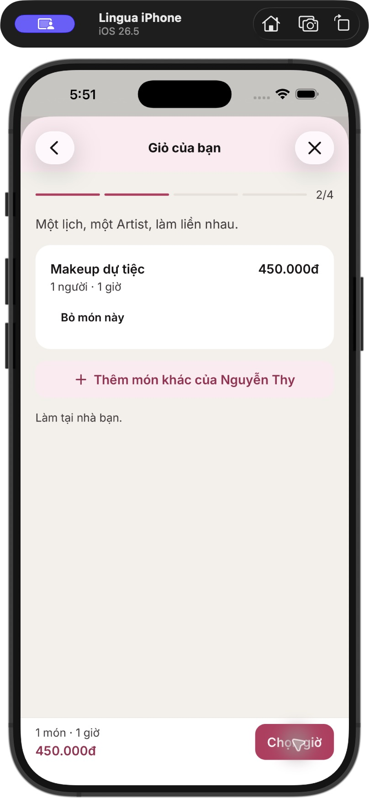

### 07 — Chọn ngày giờ: tương đối tốt

Ngày/giờ có trạng thái chọn rõ, chia theo buổi, giá cố định đáy và nút tiếp tục rõ. Cần giữ khả năng đọc này trong ref mới. Chưa kiểm chứng nhiều ngày hết lịch, lịch bận, Dynamic Type và timezone trên thiết bị khác.

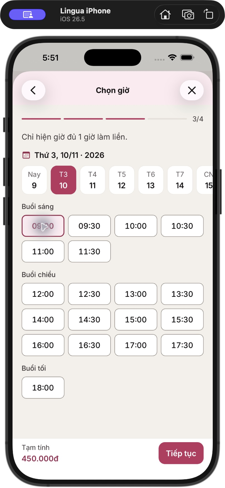

### 08 — Xác nhận: đủ thông tin cơ bản, cần giảm lặp

Chọn thành phố/phường trước đăng nhập hợp lý. Giá 450.000đ xuất hiện ba lần; chính sách huỷ/phí nằm chung một đoạn dài. Footer hiện tạm tính khi chưa có phường, nên thiết kế phải nói rõ phần phí còn thiếu thay vì tạo cảm giác đây là tổng cuối.

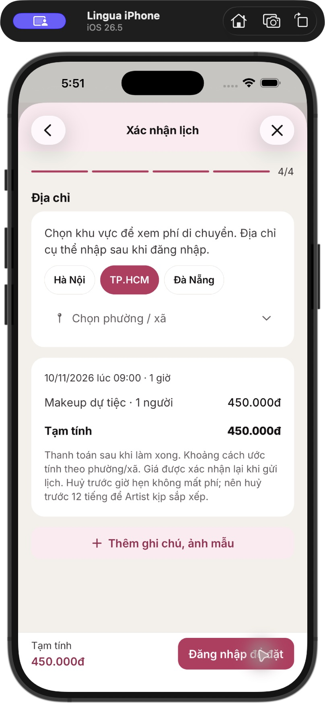

### 09 — Đăng nhập: ma sát nội dung

Logo, tiêu đề, mô tả, tabs, khối điều khoản, Apple, Google và separator đều đứng trước form. Chữ lớn là điểm tốt, nhưng có thể bớt nội dung để form ngắn hơn. “hoặc dùng email” không khớp field email/SĐT. Chưa thực hiện đăng nhập hay chấp nhận điều khoản trong audit.

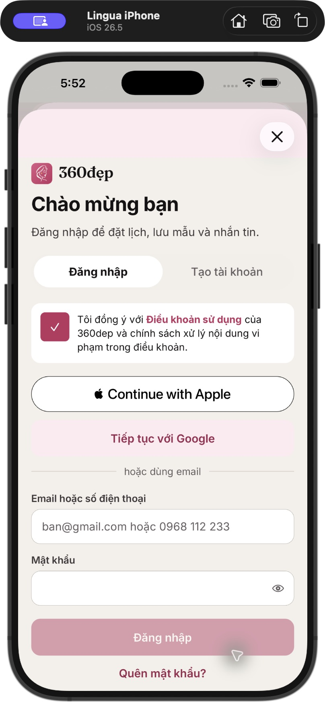

### 10 — Tìm tên trong tab dịch vụ: có kết quả liên quan

Truy vấn “Nguyen Thy” trong native trả cả hai dịch vụ của người này và số lượng Artist. Đây là điểm tốt, không gán lỗi tìm tên của source web cho native. Ảnh dự tiệc ở kết quả lại khác ảnh cùng dịch vụ tại trang danh mục, làm giảm tính liên tục thị giác.

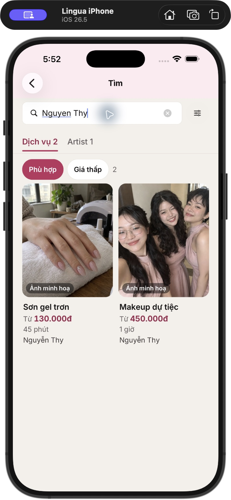

### 11 — Kết quả Artist: gọn nhưng giá thiếu ngữ cảnh

Thẻ người làm gọn hơn những màn khác. “Từ 130k Mới · Phường…” ghép giá, trạng thái và vị trí trên một dòng, không nói 130k cho dịch vụ gì. Tách giá theo gói khỏi dữ kiện hồ sơ.

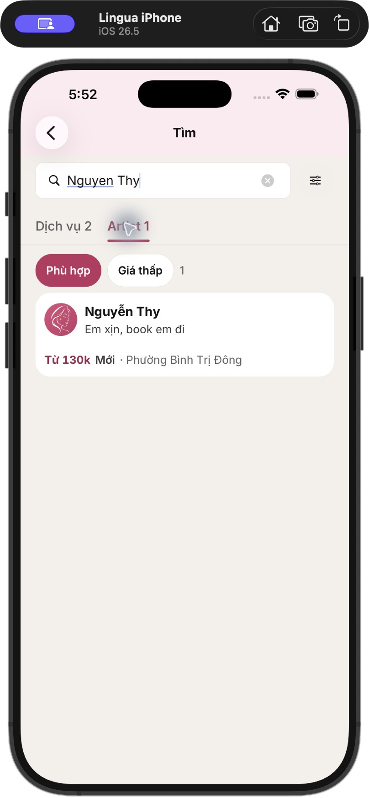

### 12 — Bộ lọc: hoạt động được, quá nhiều lựa chọn cùng cấp

Ngành và danh mục dài trước khi đến nơi phục vụ; hơn chục pill khiến khách đọc nhiều. Footer Xoá lọc/Xem kết quả tốt, nên giữ. Chưa kiểm thử đầy đủ tất cả tổ hợp.

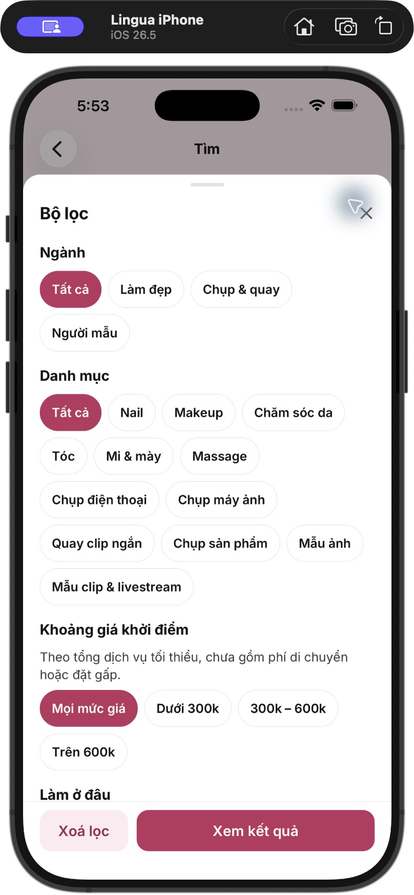

### 13 — Makeup đã lọc nhưng giá là nail: lỗi đã tái hiện

Chip Makeup đang bật, tab Artist có một người, thẻ vẫn “Từ 130k”. Đối chiếu ảnh 04: 130.000đ là Sơn gel, Makeup dự tiệc là 450.000đ. Đây là vấn đề đúng/sai thông tin, cần sửa trước khi polish thẻ.

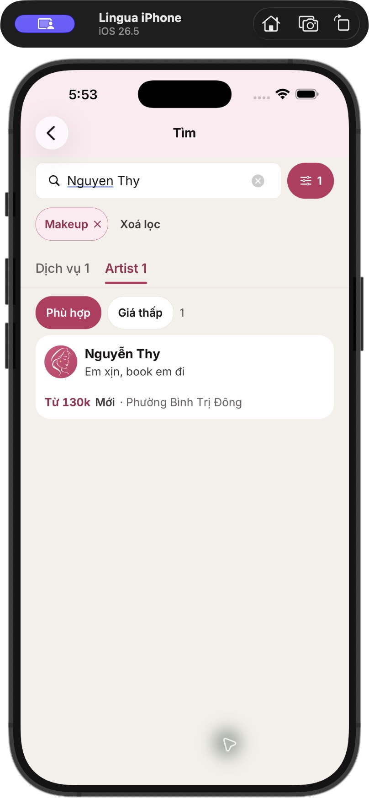

## Định hướng ref trước khi code

- Màn Khám phá mobile 390 × 844; giữ chữ thân bài khoảng 17 và chú thích 15, chỉ giảm nội dung cạnh tranh.
- Thương hiệu 360đẹp, nền sáng ấm, ink đậm, rose #BB3460 dùng có chủ đích. Tối đa hai font; serif chỉ cho nhấn thương hiệu/editorial.
- Một điểm bắt đầu rõ: chọn dịch vụ hoặc nhu cầu; giữ địa điểm nhìn thấy. Không đặt hai cơ chế nhận đơn thành quyết định chính ở Home.
- Ba hướng ảnh độc lập để so sánh: dịch vụ trước; cảm hứng hình ảnh trước; đặt nhanh theo nhu cầu. Ảnh concept có dữ liệu minh hoạ, không phải bằng chứng nguồn cung hay chất lượng của đối tác thật.
- Sau khi chọn hướng mới mới triển khai component và thử các trạng thái ít dữ liệu, đang tải, mất mạng, chưa đăng nhập, chữ lớn. Chưa có chấp thuận code trong bước này.

## Bổ sung source-only

- [Native: 10 phát hiện và dẫn nguồn](NATIVE-SOURCE.md).
- [Web: lỗi tìm kiếm, giữ ngữ cảnh, spa, typography và accessibility](WEB-SOURCE.md).
- Các lỗi spa “giờ hôm nay sang ngày mai”, “Gần nhất” thiếu vị trí và mất service trên profile mới được thấy trong source, chưa tái hiện bằng UI ở lần này.
