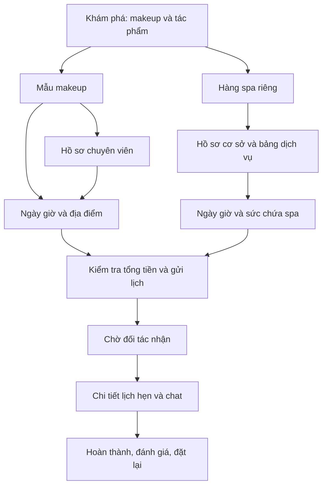

# Kế hoạch tổng thể 360đẹp sau đối chiếu massageapp

Ngày 09/11/2026 · **Đề xuất trước khi code** · Phạm vi: app iOS/Android, web khách hàng, Studio, spa và admin.

## 1. Kết luận và hướng sản phẩm

360đẹp nên tiếp tục là nơi **khám phá tác phẩm và đặt chuyên viên làm đẹp**, lấy makeup làm trọng tâm. Phần đáng tích hợp từ massageapp là cách giữ lựa chọn xuyên luồng, chất lượng hồ sơ/đánh giá, lịch sử đặt lại, công cụ CSKH, theo dõi đơn và các biện pháp bảo toàn giao dịch. Không thay nền tảng 360đẹp bằng mô hình gọi massage ngay.

Hai việc phải đi cùng nhau: giao diện cho thấy đủ tác phẩm/chuyên viên để khách lựa chọn; dữ liệu và vận hành giúp khách đặt đúng gói, đúng giá, đúng lịch. Nhiều card hơn không khắc phục được thiếu ảnh thật hoặc thiếu người cung cấp dịch vụ.

### Cơ sở thiết kế và trạng thái chốt mẫu

- Giữ [home ưu tiên makeup](refs-v2-makeup/02-makeup-first.png): feed hai cột, ảnh tác phẩm đi cùng tên người làm, dịch vụ và giá; makeup chiếm phần nổi bật.
- Spa có shortcut và một hàng cơ sở riêng phía dưới; không chen vào lưới makeup chính.
- [Ba loại detail](detail-refs/README.md) đã được đề xuất: mẫu makeup/dịch vụ cụ thể, hồ sơ chuyên viên, hồ sơ spa. Chưa có xác nhận riêng cho detail; cần chốt cùng kế hoạch trước triển khai các màn này.
- Khách có thể xem và chọn trước đăng nhập. Đăng nhập không làm mất bản nháp đặt lịch.
- Chưa có yêu cầu triển khai code trong bước này. Các đề xuất mới dưới đây chưa được coi là chức năng đã làm.

## 2. Nguồn kiểm tra và giới hạn

| Nguồn | Mốc đã đối chiếu | Ý nghĩa |
|---|---|---|
| massageapp | `main@d79532097a1ec3b358c87c420b3298d24b12d011` | `git ls-remote` xác nhận cùng HEAD/main trên remote tại lần rà soát này |
| 360đẹp đang làm | `feat/spa-venues@d3080516a0bb0ef9b4bc00c5465f0508894f3bba` | Khớp remote nhánh spa; có nhiều dịch vụ trong một lịch và spa nhiều giường |
| 360đẹp main | `54ddfb535fdd40b764bde7714091f3259c3d9381` | Khác nhánh spa; không được suy ra spa đã phát hành từ code nhánh này |
| UX hiện tại | [Audit native và 13 ảnh trong phiên](AUDIT.md) | Bằng chứng UI cho các lỗi giá/filter và chọn lại gói đã nêu |
| So sánh lần này | [Bằng chứng nguồn và quyết định tích hợp](SOURCE-COMPARISON.md) | Đọc code, migration, test và lịch sử Git; không chạy lại app, database hay giao dịch |

Đã xem các nhóm khách hàng, đối tác, admin/CSKH, tiền, xác minh/phân quyền, thông báo, ngôn ngữ, phát hành và các thay đổi mới 01–09/11. Đây không phải kiểm thử từng dòng code hay chứng nhận production. README cũ và commit title chỉ dùng để tìm nguồn; nhận định tính năng dựa vào phần triển khai tương ứng.

`massageapp/package.json` đang có sửa local; thư mục `docs/design/spa-partner-2026-11-08/` chỉ là ref chưa track. Không dùng những ảnh đó để kết luận massageapp đã vận hành spa. Không sửa các thay đổi có sẵn ở hai repo.

## 3. Mang gì sang, giữ gì đang có

| Nhóm | Hướng thực hiện | Ưu tiên / mốc |
|---|---|---|
| Giữ lựa chọn qua feed → detail → đặt | Học draft của massage; chuẩn hóa ngữ cảnh người/mẫu/gói/ngày giờ; giữ giỏ nhiều dịch vụ của 360đẹp | P0, M1–M2 |
| Giá và bộ lọc | Sửa giá của đúng nhu cầu; cùng một cơ sở giá cho card, sort, detail và báo giá | P0, M1 |
| Gallery hồ sơ | Học upload/sắp xếp ảnh/kiểm quyền; tách ảnh nhận diện, tác phẩm và ảnh cơ sở; dùng lại kho works | P1, M1/M3 |
| Review khách hiện ngay | Đề xuất sau lịch hoàn thành và kiểm tra nội dung tự động; trường hợp bị gắn cờ xử lý riêng; giữ báo cáo/ẩn/phản hồi | P1, M2 |
| Lịch sử và đặt lại | Nhóm tháng, lọc trạng thái; đặt lại giữ chuyên viên và giỏ, kiểm lại giá/khả dụng | P1, M2 |
| Chat và theo dõi buổi hẹn | Giữ engine hiện có; bổ sung hành động nhanh, timeline và cách khôi phục khi có lỗi | P1, M2 |
| Bàn vận hành trực tiếp | Thêm đơn cần xử lý theo thời gian, nguyên nhân thất bại và bước tiếp theo cho CSKH | P1, M3 |
| Hồ sơ khách và ghi chú CSKH | Mở rộng bảng khách hiện có thành detail; ghi tác giả/thời gian và liên kết vụ việc/lịch hẹn | P1, M3 |
| Phân quyền nhân viên | Học support/admin; kiểm cả API/DB, giữ ranh giới MCN và dữ liệu riêng tư | P0 trước M3 |
| Danh sách đối tác phục vụ vận hành | Lọc nghề/khu vực/ảnh còn thiếu/lịch gần nhất/phiên bản app; trạng thái “hoạt động gần đây” | P1, M3 |
| Tuyển đối tác web → app | Deep link đúng loại Artist/spa, giữ mã mời, có fallback web/store | P1, M3 |
| Đối soát SePay hiện có | Kiểm đúng tài khoản nhận, ghi nguyên tử/chống ghi trùng, trả lỗi để retry nếu chưa lưu được | P0, M0 |
| Thanh toán QR cho khách và chi trả | Học quy trình đối soát/hoàn/rút tiền, nhưng tách thành dự án con sau khi chốt nghiệp vụ 360đẹp | P2, M4 |
| Push, vòng đời lịch hẹn, crash | Sửa token khi đổi tài khoản; rà tự hoàn tất; báo lỗi có che dữ liệu; kiểm cấu hình phát hành | P0 nền tảng, M0–M2 |
| Đa ngôn ngữ | Chuẩn bị text keys/format; VI/EN trước, dịch nội dung có bản gốc sau | P2, M4 |
| Hạng thành viên, affiliate, quảng cáo SDK | Đánh giá sau khi có số liệu đặt hoàn thành và kinh tế đơn hàng; tránh chồng thưởng với MCN/referral | P2, M4 |
| Công cụ ưu đãi/thông báo theo nhóm | Có thể học form quản trị, lựa chọn người nhận và lịch sử; dùng sau quyền staff và định nghĩa voucher, không đưa banner khuyến mại lên chiếm home | P2, M4 |

### Đã có, cần nâng chất lượng thay vì xây lại

- Sắp xếp Artist theo khoảng cách/đặt nhiều/đánh giá/đối tác mới; bán kính và Bayesian rating.
- Kho tác phẩm, album theo ngành, ảnh/video; bảng giá và ghi chú gói makeup.
- Đổi/hủy lịch, no-show, khiếu nại, chat, gửi ảnh/vị trí, báo cáo/chặn và review có ảnh.
- Nhiều dịch vụ trong một lịch, lịch nhiều buổi, bàn giao ảnh của nghề chụp ảnh; spa có sức chứa riêng trên nhánh hiện tại.
- Studio: onboarding, nhận việc, lịch, tác phẩm, ví/phí; admin có hàng chờ, duyệt/gỡ hồ sơ, khóa và reset mật khẩu.
- Referral voucher và MCN có quy tắc riêng. Không tạo hệ thống affiliate thứ ba trong đợt đầu.
- Trợ giúp và danh sách câu hỏi chưa có câu trả lời trong admin đã có; cải thiện nội dung theo câu hỏi thực tế thay vì dựng trợ lý mới.

### Không mang nguyên từ massageapp

- Gọi ngay/ghép KTV theo thời điểm hiện tại; ẩn mọi người không online; xin GPS ngay khi mở app.
- Phụ thu cố định vì có dấu xác minh, mốc CCCD từ đơn thứ tư, khóa ảnh chân dung do AI tạo.
- Bộ lọc tuổi/giới tính làm trọng tâm khám phá makeup; cam kết và nội dung đặc thù massage.
- Catalog massage, hoa hồng 15%, hạn hủy 2 giờ, mã tiền MA/MAT/MF, tài khoản ngân hàng hoặc cấu hình store của Medi24h.
- Bộ giao diện raspberry của massage thay cho ref 360đẹp đã duyệt; web chỉ còn landing như massage.

## 4. Trải nghiệm đích và bản đồ màn hình

Hồ sơ chuyên viên là đường tùy chọn để xem thêm bằng chứng; khách đang xem đúng mẫu có thể đi thẳng tới chọn giờ. Không bắt mọi người đi qua đủ các node. “Gửi lịch” vẫn là chờ đối tác nhận, không hứa đã xác nhận khi server chưa có trạng thái đó.

| Khu vực | Nội dung và hành vi đích |
|---|---|
| Khám phá | Header/search/location gọn, makeup đứng đầu; feed hai cột liên tục, đa dạng người làm; không có khối lớn hỏi cơ chế đặt trước khi thấy tác phẩm |
| Danh mục / tìm kiếm | Kết quả dịch vụ và người làm đều hiểu truy vấn tên; filter dùng đúng giá/dịch vụ/địa bàn; trạng thái thiếu nguồn cung nhìn thấy được |
| Mẫu makeup | Gallery kết quả/góc cận, gói và người làm đi cùng nhau, phần bao gồm/phụ phí, tác phẩm liên quan; CTA cố định |
| Hồ sơ Artist | Khu vực phục vụ, bảng giá, nhiều tác phẩm, review, giới thiệu; ảnh nhận diện riêng; chọn gói không làm mất mẫu đang xem |
| Spa list / detail | Địa chỉ, chỉ đường, ảnh cơ sở, giờ mở cửa, dịch vụ, tiện nghi; không suy ra còn lịch từ giờ mở cửa; không phí di chuyển Artist |
| Chọn giờ | Một tóm tắt gói có thể sửa/thêm; mở thẳng calendar khi đã có gói hợp lệ; slot tính trên toàn giỏ và nơi phục vụ |
| Xác nhận | Ngày giờ, người/cơ sở, địa điểm, giá dịch vụ, di chuyển/phụ phí, giảm giá và tổng cuối; ảnh mẫu/ghi chú là phần bổ sung |
| Đăng nhập | Form gọn, nhãn SĐT/email đúng; quay lại đúng bản nháp sau đăng nhập/OAuth; không yêu cầu lại các bước đã chọn |
| Lịch hẹn / detail | Việc cần làm tiếp theo, trạng thái và mốc thời gian thật, chat theo quyền, đổi/hủy/hỗ trợ; lịch nhiều dịch vụ gộp đúng một đơn |
| Đã qua / đặt lại | Nhóm theo tháng; giữ người và gói nhưng báo lại giá/lịch hiện tại; không lấy giờ cũ hoặc tổng tiền cũ để xác nhận tự động |
| Tôi / đã lưu | Tác phẩm và chuyên viên đã lưu, địa chỉ, hỗ trợ, cài đặt; khôi phục tài khoản và trạng thái lỗi rõ |
| Studio Artist | Hôm nay và lịch cần nhận; đăng tác phẩm gắn gói; cập nhật giá, vùng phục vụ, giờ/ngày nghỉ; trạng thái hồ sơ còn thiếu rõ |
| Studio spa | Địa chỉ/ảnh/tiện nghi, dịch vụ, giờ và số giường; lịch theo sức chứa; không áp trạng thái Artist “đang tới khách” |
| Admin / CSKH | Đơn cần xử lý → hồ sơ khách/chuyên viên → lịch sử và ghi chú → hành động được cấp quyền; không chỉ có bảng số tổng |

### Quy tắc mật độ và nguồn cung

- Thiết kế tham chiếu 390 × 844: có thể thấy khoảng bốn card chính khi dữ liệu đủ, tên/giá vẫn đọc được. Đây là mục tiêu bố cục cần đo trên native, không ép đủ bốn card bằng cách thu nhỏ chữ hoặc tạo dữ liệu giả.
- Feed tiếp tục qua nhiều lượt cuộn; phân trang và danh sách tái sử dụng item trên native, thumbnail đúng kích thước. Không coi bốn card của ảnh ref là toàn bộ nội dung home.
- Mỗi card thuộc một chuyên viên và một gói cụ thể; dùng tác phẩm đúng người, đúng dịch vụ. Gói nhóm ghi đơn giá và tổng tối thiểu; gói cô dâu tách thử/gia tiên/tiệc cưới.
- Khi ít nguồn cung: nới quy tắc giãn cách cùng Artist một cách có kiểm soát, hiển thị thêm tác phẩm thật, nhóm gợi ý có nhãn và lối gửi nhu cầu. Không nhân bản người làm, đánh giá hoặc ảnh minh họa thành portfolio thật.
- Duy trì bước vận hành bổ sung tác phẩm: ảnh đúng nghề, liên kết gói/biến thể, quyền sử dụng và kiểm duyệt. Dashboard chỉ ra hồ sơ thiếu dữ liệu để nhân viên hỗ trợ hoàn thiện.

## 5. Hợp đồng dữ liệu và những phần phải bảo toàn

### Booking intent chung cho web và native

Giữ `proId`, `providerKind`, `workId`, danh sách `templateId/variantId/quantity`, nơi phục vụ, ngày/giờ dự kiến và phiên bản bản nháp. Chỉ lưu dữ liệu cần thiết; không đưa địa chỉ riêng/ghi chú/ảnh nhạy cảm vào analytics hay URL chia sẻ.

Mỗi lần khôi phục, đổi gói, đổi địa chỉ hoặc trước gửi lịch đều kiểm lại gói còn bán, giá hiện tại, phạm vi phục vụ và lịch. Server là nguồn giá và trạng thái cuối. Có thay đổi phải báo khách trước khi xác nhận. Một lịch nhiều dịch vụ vẫn giữ cấu trúc giỏ/đơn con hiện có.

Mỗi lần gửi dùng một operation ID bền vững: retry cùng payload trả lại cùng đơn; payload đổi không được dùng lại ID để tạo kết quả mơ hồ. Điều này bổ sung cho giao dịch atomic/khóa lịch hiện có, xử lý trường hợp server đã tạo đơn nhưng mạng làm khách không nhận được phản hồi.

### Ba trạng thái phải tách biệt

1. **Hồ sơ đang nhận lịch:** người/cơ sở cho phép đặt.
2. **Hoạt động gần đây:** tín hiệu app/version để CSKH hỗ trợ, có thời điểm cập nhật.
3. **Còn slot cụ thể:** kết quả kiểm lịch/sức chứa cho gói, ngày giờ và số người đã chọn.

Không dùng lần mở app để quảng cáo “online/rảnh”. Không ẩn portfolio của người có thể nhận lịch tuần sau chỉ vì hiện không mở app.

### Tiền, trạng thái và quyền

- Giữ chính sách hiện tại làm baseline: hoa hồng mặc định 20%, MCN theo cấu hình/đơn, hủy miễn phí trước 12 giờ và phí hiện hành. Các thay đổi kinh doanh không nằm lẫn trong PR UI.
- Gia cố SePay nạp ví trước. Không tự mở thu tiền khách/giữ hộ tiền/chi trả mới chỉ vì source massage có sẵn.
- Mọi chuyển trạng thái hoàn thành, hủy, vắng mặt, giữ tiền và trả tiền phải kiểm tại DB; job chưa bắt đầu không tự sinh doanh thu như đã phục vụ.
- Phân quyền rõ khách, Artist, quản lý spa, CSKH, admin và MCN. CSKH đọc thông tin cần hỗ trợ nhưng không tự cấp quyền/đổi phí/chuyển tiền; notes và thao tác quan trọng có nhật ký.
- Giữ chat theo vòng đời lịch hiện tại; không mở chat trước nhận lịch như một tính năng mới trong ref.
- Push cần gỡ liên kết tài khoản khi logout/đổi tài khoản, có đường phục hồi offline; không khóa người dùng trong tình trạng không thể đăng xuất. Bổ sung outbox/receipt/retry và nội dung lock screen phù hợp, tách khỏi nội dung đầy đủ trong app.
- Xác minh danh tính có cờ/chính sách hiện tại của 360đẹp; không bật hoặc đổi ngưỡng bằng việc port kỹ thuật upload.

## 6. Lộ trình thực hiện sau khi duyệt kế hoạch

Các mốc là thứ tự phụ thuộc, chưa là cam kết ngày giao. M0 và phần hình ảnh M1 có thể làm song song; các hàng P0 phải đạt trước phát hành công khai.

| Mốc | Công việc / đầu ra | Điều kiện kết thúc |
|---|---|---|
| **M0 — Nền dữ liệu và phát hành** | Xác định baseline có spa; booking intent/quote contract; sửa token push khi đổi tài khoản, auto-complete, SePay; đặc tả sự kiện và quyền; crash có che dữ liệu | Kiểm thử giao dịch/lịch/quyền đạt; app cũ tương thích; chưa thêm phương thức thu tiền mới |
| **M1 — Khám phá và detail** | Hiện thực home đã chốt; chốt và triển khai ref detail đề xuất; search/filter đúng giá; tác phẩm và gallery; trạng thái ít dữ liệu/loading/error; web cùng cấu trúc | Từ card tới detail cùng người/gói/giá; không có spa trong grid chính; review trực quan trên iOS/Android/web |
| **M2 — Đặt và dùng dịch vụ trọn luồng** | Calendar trực tiếp, giỏ tùy chọn, xác nhận/login, lịch hẹn/timeline/chat, review, lịch sử/đặt lại; ref bổ sung cho màn chưa có | Chạy hết khách → đối tác → hoàn thành; thử đổi/hủy/no-show/mạng lỗi; nhiều dịch vụ và spa không mất quy tắc |
| **M3 — Nguồn cung và vận hành** | Studio tác phẩm/giá/giờ; cơ sở spa; deep link tuyển; CRM/notes, roster, theo dõi lượt đặt và đơn cần xử lý; quyền support/admin | Tác phẩm đã duyệt xuất hiện đúng feed; CSKH lần được nguyên nhân và hành động tiếp theo; quyền DB/API được kiểm |
| **M4 — Mở rộng có điều kiện** | QR cho khách/hoàn/rút tiền nếu chốt nghiệp vụ; VI/EN rồi dịch; đặt hộ; thành viên/affiliate/SDK quảng cáo nếu có nhu cầu đo được | Mỗi nhóm có spec, nguồn tiền/quyền/chi phí và kế hoạch phát hành riêng; không trì hoãn đợt UX chính để chờ tất cả |

### Chia việc và PR để dễ kiểm

- Nhánh nền: domain, migration tương thích ngược, sửa lỗi P0 và test hành vi.
- Nhánh trải nghiệm: token/component, home/search/detail rồi booking/history; cùng contract cho web và native.
- Nhánh vận hành: Studio và admin dựa trên contract/quyền đã xong; không mỗi màn tự định nghĩa trạng thái/giá riêng.
- Port từng module/nguyên tắc có test, không cherry-pick toàn bộ lịch sử hoặc migration massage. Dùng migration mới của 360đẹp; giữ nguyên schema lịch/giỏ/MCN/spa đang có.
- Không tạo package chung giữa hai dự án trong đợt đầu; đánh giá sau khi có hai triển khai ổn định và nhu cầu bảo trì thực tế.

### Các ref còn cần hoàn thiện trước màn tương ứng

Home đã chốt; detail đã có ref đề xuất để chốt cùng plan. Cần thêm: tìm kiếm và filter; chọn giờ/địa điểm/xác nhận; lịch hẹn và chat; review/đặt lại; Studio Hôm nay/đăng tác phẩm; spa calendar; admin dashboard/CRM. Thiết kế cả dữ liệu phong phú, ít dữ liệu và lỗi, không chỉ một màn đẹp với mock data.

## 7. Tiêu chí nghiệm thu

| Nhóm | Tình huống bắt buộc |
|---|---|
| Đúng người/gói/giá | Từ makeup 450k không rơi về nail 130k; sort/filter cùng giá; cô dâu đúng biến thể; nhóm đúng tổng tối thiểu |
| Liên tục | Feed → work → profile → giờ; back/login/OAuth/deep link/reopen giữ intent; giá đổi hoặc gói bị tắt được báo và chọn lại có chủ đích |
| Lịch | Hai khách tranh cùng slot; giỏ dài qua giờ đóng; đổi lịch; thời gian UTC+7 trên máy timezone khác; nhận/hủy không làm trùng lịch |
| Spa | N giường cho N đơn đồng thời, đơn N+1 không vượt chỗ; lịch chọn hôm nay không sang ngày mai; không phí đi lại, không “đang tới khách” |
| Vòng đời | Chưa bắt đầu không tự hoàn tất; khiếu nại/hold ngăn quyết toán; thao tác lặp không thu/trừ hai lần; app cũ không phá state mới |
| Tiền | Sai tài khoản nhận, webhook lặp/đồng thời, id test, amount không hợp lệ, DB lỗi, giao dịch chưa khớp; không báo thành công khi chưa lưu bền vững |
| Push / quyền | Logout hoặc đổi tài khoản không nhận push người trước; khách/Artist/spa/CSKH/MCN không đọc hoặc sửa vượt phạm vi |
| Review / ảnh | Chỉ lịch hợp lệ được review; review ẩn không tính điểm; không lộ đánh giá riêng của đối tác về khách; upload/reorder/delete đúng owner |
| UI / accessibility | Màn nhỏ, safe area, chữ hệ thống lớn, screen reader, bàn phím web, vùng bấm; CTA không che nội dung; ảnh hỏng/mạng chậm có đường tiếp tục |
| Hiệu năng | Feed phân trang, ảnh thumbnail, không tải toàn bộ review/portfolio cho home; đo scroll/memory trên thiết bị thực tế trước phát hành |
| Vận hành | Notes đúng tác giả/thời gian; filter giữ khi quay lại; mỗi booking attempt có kết quả; “không có dữ liệu” không hiển thị thành 0 hoặc online |

Khi triển khai sẽ chạy typecheck/lint/test/build web và typecheck/lint native, catalog consistency, SQL business rules, partner-flow, MCN, RLS; thêm test cho những rủi ro mới thực sự thay đổi. Đợt lập kế hoạch này không chạy test hay tạo môi trường vì chưa sửa code.

## 8. Đo lường và phát hành

### Chỉ số phục vụ quyết định

- Khám phá → mở tác phẩm/hồ sơ → chọn gói → chọn giờ → gửi lịch → đối tác nhận → hoàn thành.
- Lỗi theo bước và nguyên nhân: không có gói, ngoài vùng, hết giờ, đổi giá, đăng nhập, mạng/server, hết hạn hoặc từ chối.
- Thời gian nhận lịch; tỷ lệ hủy/no-show; tỷ lệ đặt lại; số tác phẩm hợp lệ/chuyên viên; tỷ lệ hồ sơ đủ ảnh và có giá.
- Tách sự kiện tương tác khỏi kết quả server; không gọi bấm nút “đặt thành công” hoặc gửi yêu cầu là doanh thu. Phân biệt giá trị đơn, thanh toán và hoàn thành.
- Chỉ gửi mã loại sự kiện/ID kỹ thuật được phép và thuộc tính không nhạy cảm; không gửi nội dung chat, CCCD, địa chỉ chi tiết, điện thoại hoặc ảnh khách vào analytics/crash/SDK quảng cáo.
- Lấy baseline trước release; chưa hứa tăng conversion bao nhiêu khi chưa có số liệu.

### Trình tự ra bản

1. Migration mở rộng tương thích app cũ → kiểm quyền và dữ liệu → API/web → bản native preview.
2. QA iOS/Android/web trên dữ liệu kiểm thử, gồm khách/Artist/spa/CSKH. Dùng simulator/stack sẵn có theo quy định disk hygiene; không tạo stack riêng cho từng nhánh.
3. Kiểm URL/key công khai, bundle/runtime/channel trước publish; native module mới cần binary mới. Việc đưa OTA vào 360đẹp cần cấu hình riêng vì hiện app chưa có runtimeVersion tương đương massage.
4. Kiểm thử beta rồi phát hành theo phạm vi được duyệt. Tách rõ code đã merge, web đã deploy, migration đã áp, store đang review và bản đã public.
5. Có khả năng tắt màn/tính năng mới về đường cũ, không rollback bằng cách xóa ledger hoặc dữ liệu lịch. Biến đổi review cũ cần kịch bản chuyển đổi và nhật ký riêng.

## 9. Các lựa chọn mới — mặc định đề xuất trong plan

| Lựa chọn | Mặc định đề xuất |
|---|---|
| Chính sách review | Review khách sau hoàn thành hiện ngay khi qua kiểm tra nội dung tự động; chỉ nội dung bị gắn cờ chờ xử lý, có trạng thái và thời hạn phản hồi; giữ báo cáo/ẩn/phản hồi |
| Tiền khách | Giữ phương thức hiện tại trong đợt UX; chỉ gia cố tiền nạp ví. QR thu khách/hoàn/rút tiền ở M4 có spec riêng |
| Ngôn ngữ | Tiếng Việt trước; chuẩn bị nền VI/EN, không bê đủ bảy ngôn ngữ ngay |
| Trạng thái online | Hiển thị nhận lịch và slot thật; hoạt động gần đây phục vụ hỗ trợ, không hứa còn người rảnh |
| Ảnh | Tác phẩm thật làm nội dung chính; ảnh AI chỉ khi có mục đích và nhãn phù hợp, không thay kết quả tay nghề thật |
| Referral/MCN | Giữ cơ chế hiện tại; chưa bổ sung affiliate tiền mặt hoặc hạng giảm giá chồng lên |
| GPS / xác minh | Xin vị trí theo hành động; giữ cờ và chính sách xác minh hiện tại |

Bỏ chế độ đợi hai bên cùng đánh giá giúp review xuất hiện sớm nhưng đối tác có thể đọc review khách trước khi đánh giá ngược. Đề xuất giữ đánh giá khách riêng tư, có kênh khiếu nại và không dùng riêng điểm đó để tự động phạt/xếp hạng khách; quy tắc xử lý đánh giá trả đũa và review cũ phải chốt trong spec M2. Chưa thay policy hiện hành ở bước lập plan.

Plan này là đầu ra để rà soát phạm vi trước triển khai. Không có thay đổi ứng dụng, migration, cấu hình dịch vụ hoặc phát hành nào được thực hiện trong lần lập plan.
