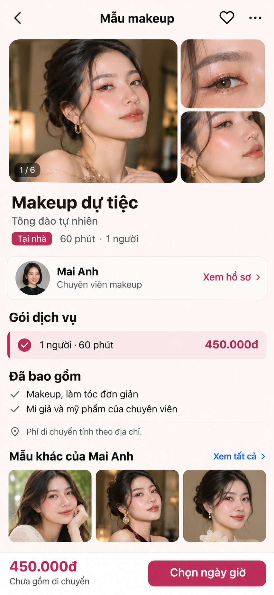
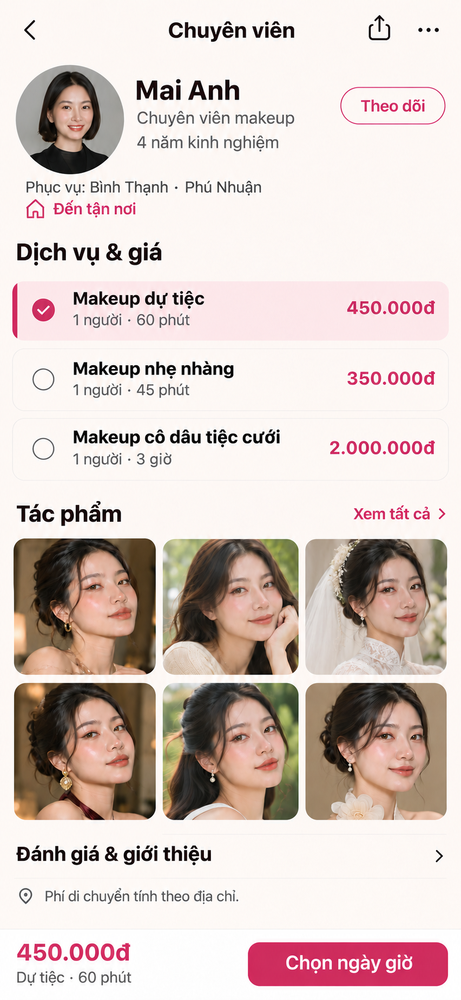
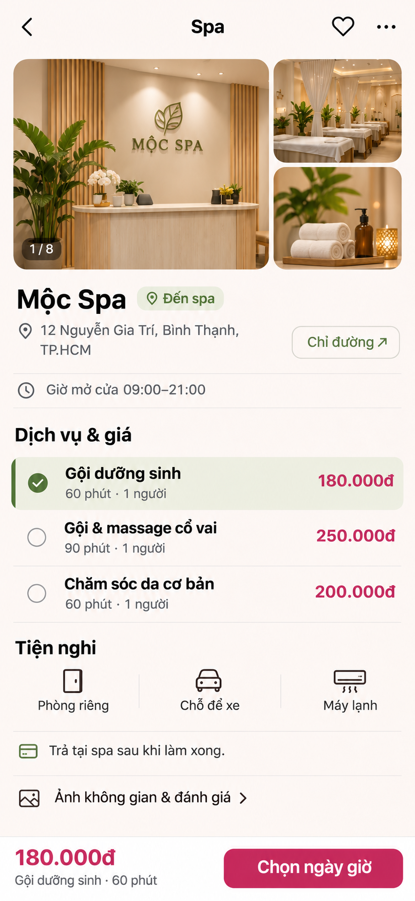

# Reference các trang detail — 360đẹp

Ngày: 09/11/2026. Tiếp nối [feed ưu tiên makeup đã duyệt](../refs-v2-makeup/02-makeup-first.png). Ba màn dưới đây cùng một hướng thiết kế, phục vụ ba ngữ cảnh khác nhau. Đây là ảnh reference; chưa sửa mã ứng dụng.

## 1. Mẫu makeup / dịch vụ cụ thể

- Ảnh kết quả makeup và góc cận đứng đầu; tên mẫu, chuyên viên, gói giá và hình thức tại nhà nằm ngay sau ảnh.
- Ví dụ: Mai Anh, makeup dự tiệc, 450.000đ / 60 phút / 1 người. Giá này giữ nguyên khi mở hồ sơ và đi tiếp tới đặt lịch.
- Ghi rõ phần bao gồm và phí di chuyển chưa tính; thêm tác phẩm cùng chuyên viên để khách so sánh.
- Thanh dưới cố định hiển thị giá và nút “Chọn ngày giờ”. Không thêm chat trước khi chuyên viên nhận lịch.

## 2. Hồ sơ chuyên viên

- Chân dung, chuyên môn, khu vực phục vụ; bảng giá ba gói trước phần giới thiệu dài.
- Lưới sáu tác phẩm để khách có đủ lựa chọn và đánh giá tay nghề.
- Gói dự tiệc 450.000đ / 60 phút được giữ khi khách đến từ mẫu tương ứng. Gói nhẹ nhàng 350.000đ / 45 phút và cô dâu tiệc cưới 2.000.000đ / 3 giờ là ví dụ ở hạng chuyên viên này.
- Đánh giá và giới thiệu có lối mở riêng; dữ liệu thật sẽ quyết định nội dung. Không tạo số đánh giá hoặc huy hiệu xác thực giả.
- Bản đã chỉnh ghi rõ “Phục vụ: Bình Thạnh · Phú Nhuận”, dùng biểu tượng ngôi nhà cho “Đến tận nơi”, và phân biệt riêng gói cô dâu tiệc cưới với gia tiên.

## 3. Hồ sơ spa

- Ảnh cơ sở, địa chỉ, chỉ đường và giờ mở cửa xuất hiện trước bảng dịch vụ. Nhãn “Đến spa” phân biệt với chuyên viên đến tận nơi.
- Ba gói nhìn thấy cùng lúc: gội dưỡng sinh 180.000đ / 60 phút; gội và massage cổ vai 250.000đ / 90 phút; chăm sóc da cơ bản 200.000đ / 60 phút.
- Gói đang chọn, giá và thời lượng đồng nhất với thanh đặt lịch ở đáy. Không có phí di chuyển của chuyên viên.
- Tiện nghi và “Trả tại spa sau khi làm xong” hỗ trợ quyết định. Giờ mở cửa không đồng nghĩa còn lịch trống.
- Spa được mở từ danh mục hoặc hàng spa riêng dưới feed; không xuất hiện trong lưới makeup chính hay chen vào detail makeup.

## Hành vi cần giữ khi triển khai sau này

Từ thẻ feed → mẫu makeup → hồ sơ chuyên viên → chọn ngày giờ phải giữ chuyên viên, mẫu, dịch vụ và biến thể đang chọn (`proId`, `workId`, `templateId`, `variantId`). Khách được chủ động đổi gói tại hồ sơ, không bị yêu cầu chọn lại cùng dịch vụ.

“Chọn ngày giờ” là đề xuất rút gọn luồng. Mã hiện tại vẫn bắt đầu từ bước chọn dịch vụ; ảnh không chứng minh luồng này đã được sửa. Gói cô dâu cần phân biệt rõ trang điểm thử, gia tiên và tiệc cưới; gói nhóm cần hiển thị giá/người, số người tối thiểu và tổng giá.

## Phạm vi kiểm chứng

- Cả ba PNG có kích thước 852 × 1846, tương đương khoảng 390 × 845 khi thu theo chiều rộng. Đây là khung nội dung tham chiếu, chưa bao gồm kiểm thử safe area hệ điều hành.
- Đã xem ảnh để kiểm tra thứ bậc nội dung, mật độ tác phẩm và tính nhất quán của giá/gói đang chọn. Chưa kiểm thử font thật, cỡ chữ hỗ trợ tiếp cận, vùng chạm, bàn phím, cuộn hoặc trạng thái tải/lỗi trong ứng dụng.
- Tên, chân dung, tác phẩm, địa chỉ, giờ mở cửa, kinh nghiệm và tiện nghi trong ảnh là dữ liệu minh họa; mức giá lấy theo các biến thể trong catalog, không xác nhận khả năng cung cấp thực tế.
- Prompt từng màn được lưu cạnh PNG. Ảnh gốc do imagegen tạo được giữ nguyên ngoài thư mục này.
