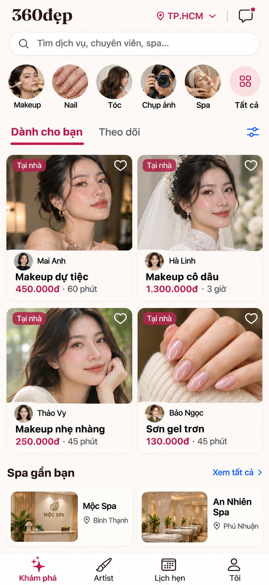

# Ref 2 — makeup là trọng tâm

09/11/2026. Chủ sản phẩm yêu cầu spa không nằm trong khung giữa/lưới chính; makeup quan trọng nhất. Bản này thay thế phương án trộn spa vào bốn thẻ chính của ref trước. Chưa có chấp thuận code.

- Lưới chính: 3 thẻ makeup (dự tiệc, cô dâu, nhẹ nhàng) + 1 nail. Có 4 chuyên viên có tên, ảnh tác phẩm, dịch vụ và giá; không có spa trong lưới.
- Makeup đứng đầu hàng danh mục và chiếm cả hai thẻ đầu. Giữ hướng feed tác phẩm đã được người dùng ưu tiên.
- Spa chỉ có shortcut và một hàng cơ sở riêng bên dưới toàn bộ lưới chính. Khi giới hạn màn nhỏ, cho spa xuống phần cuộn thay vì thu nhỏ nội dung makeup.
- Giá/thời lượng minh hoạ đối chiếu catalog: dự tiệc 450k/60 phút; cô dâu gói gia tiên/tiệc cưới cơ bản 1.300k/180 phút; makeup nhẹ 250k/45 phút; sơn gel 130k/45 phút. Tên hồ sơ và hình ảnh là mock data, không phải nguồn cung thật.
- Đã xem ảnh kết quả: đủ 3 makeup + 1 nail và 4 tên; spa nằm bên dưới. Chưa đo font/touch target, chưa thử native safe areas/chữ lớn hay hành vi feed.
- Không sửa source, không triển khai app. Prompt lưu cạnh PNG.
