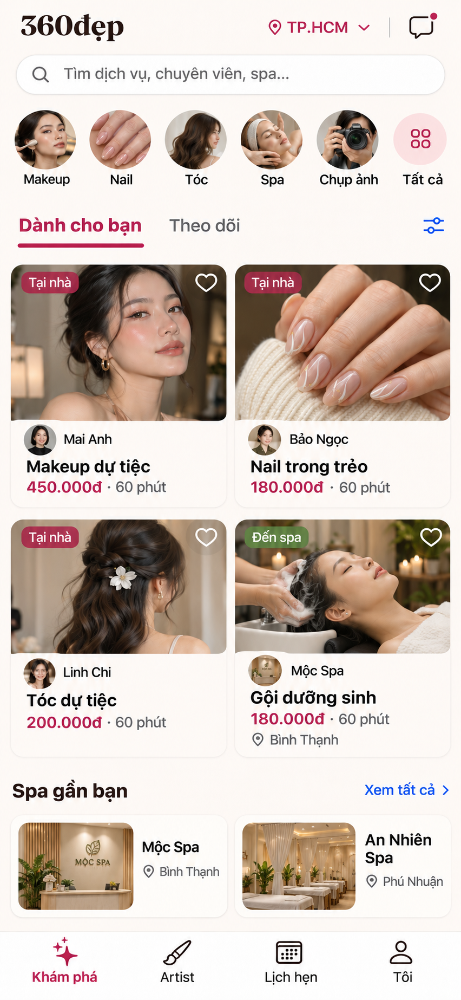

# Ref 2 — bổ sung spa (09/11/2026)

**Đã được thay thế theo phản hồi mới:** spa không nằm trong lưới chính, makeup là trọng tâm. Xem [ref makeup-first](../refs-v2-makeup/README.md). Nội dung bên dưới lưu lại phương án cũ để đối chiếu.

Chủ sản phẩm thấy hướng feed tác phẩm v2 số 2 phù hợp hơn và hỏi spa đặt ở đâu. Đây là bản tinh chỉnh đúng hướng đó, chưa phải chấp thuận code.

## Cách đưa spa vào

- **Lối vào theo danh mục:** Spa hiện ở hàng shortcut trên cùng; search gợi ý cả dịch vụ, chuyên viên và spa.
- **Cùng nằm trong feed:** bốn thẻ gồm ba chuyên viên và một dịch vụ spa. Giữ makeup/người làm tại nhà là nội dung chính theo định hướng sản phẩm hiện tại. Spa dùng tên cơ sở/ảnh không gian; không dùng chân dung cá nhân giả làm avatar spa.
- **Phân biệt cách sử dụng:** chuyên viên có nhãn Tại nhà; spa có nhãn Đến spa và khu vực. Màu là hỗ trợ, chữ mới là dấu phân biệt chính.
- **Lối chọn cơ sở:** hàng Spa gần bạn phía dưới có tên và khu vực của hai spa. Không có banner quảng cáo chung thay thế các cơ sở cụ thể.
- **Luồng sau tap:** giữ dịch vụ đã chọn → hồ sơ spa với địa chỉ, ảnh không gian, bảng giá → ngày/giờ → xác nhận chờ spa nhận. Không đi nhánh phân đơn cho Artist đến tận nhà. Không bịa giờ còn chỗ nếu chưa tải dữ liệu.
- Bottom nav giữ Khám phá / Artist / Lịch hẹn / Tôi trong ref này; Artist chỉ là directory người làm, Spa truy cập trực tiếp qua shortcut/feed/hàng cơ sở. Chưa đề xuất tab thứ năm.

## Kiểm tra ảnh concept

- Có 4 thẻ dịch vụ có tên/giá; 3 chuyên viên có tên; 2 spa có tên (Mộc Spa xuất hiện cả trong feed và hàng cơ sở, không tính thành 2 cơ sở).
- Makeup/Nail/Tóc có nhãn Tại nhà, gội dưỡng sinh có Đến spa + Bình Thạnh.
- Màn này vẫn dùng dữ liệu, chân dung và tên spa minh hoạ. Không khẳng định là nguồn cung thật trên production.
- Các giá/thời lượng trong concept không thay thế catalog hay điều kiện của từng đối tác. Luồng booking và nhãn phục vụ cần dựa dữ liệu thật khi triển khai.
- Raster không xác minh typography/touch target/accessibility; vẫn cần kiểm tra native safe area và chữ lớn khi có bước triển khai được yêu cầu.

Prompt nằm cạnh PNG. Không sửa application code.
