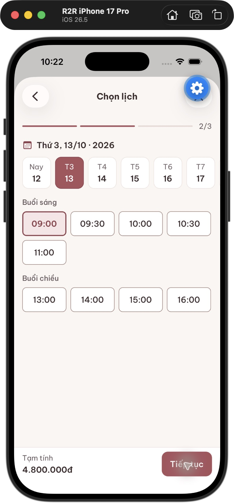
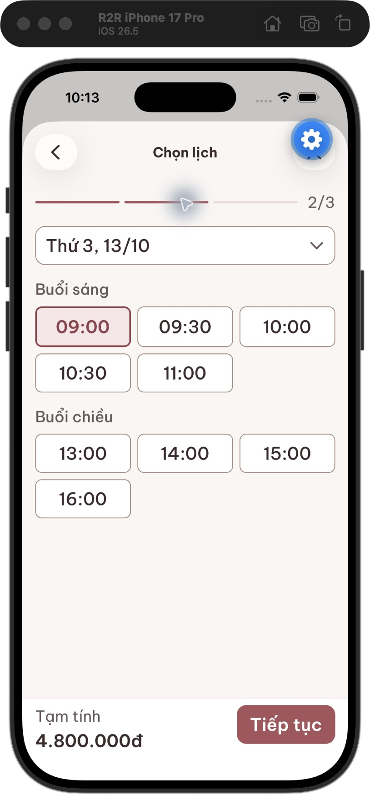

# Compact native booking — 12 October 2026

The previous change rearranged oversized controls without correcting their scale. This follow-up reduces the actual type and geometry of booking controls. No generated artwork is needed for this transaction screen.

## Visual correction

| Element | Previous accessibility-large layout | Current layout |
| --- | --- | --- |
| Time/date/action type | Body 17/26 scaled with the full system multiplier | Control 16/22, increases up to 1.35× (21.6pt) |
| Secondary interface labels | Meta 14/21 scaled without a bound | Control meta 14/20, increases up to 1.35× |
| Time targets | Large two-column tiles | Minimum 48pt targets, three columns at accessibility-large, four at normal text |
| Sections | 24pt gaps and a separate progress-label row | 16pt gaps, inline 2/3 progress |
| Footer | Full-width oversized action | Compact price and action side by side for service/date selection |
| Visible availability | Five morning slots; afternoon below the fold | All nine fixture slots, morning and afternoon, in one view |

Controls use opt-in `control`/`controlMeta` variants and `compact` props. Existing component callers keep their defaults. Paragraphs, entered notes and confirmation-price details retain the full system text scale. This is an explicit control-density choice, not an app-wide scaling change. Selected times use a stronger border, fill, weight and accessibility selected state; the absolute checkmark was removed to avoid overlap in compact cells.

## Screenshots

Same device, R2R iPhone 17 Pro / iOS 26.5 / Expo Go. The enlarged screenshot uses the same `accessibility-large` setting as the user's rejected screenshot.

| Normal text | Accessibility-large |
| --- | --- |
|  |  |

Other readbacks:

- [Date picker at large text](date-picker-large.png)
- [Exact 10:30 time picker at large text](time-picker-large.png)
- [Service selection at normal text](step1-normal.png)
- [Confirmation, prices and entered note at normal text](confirmation-normal.png)
- [Confirmation-price rows at large text](confirmation-price-large.png)

## Verified behavior

- Date picker retains the first-session 14-day range. Changing the date clears the selected time and disables continuation.
- Both the first and last available times were selected successfully.
- Second-session time picker opened with 09:00, selected 10 and 30, then applied 10:30. Compact scroll offsets aligned with the selected values.
- Optional notes opened and accepted `QA note retained`; the note and second-session time remained after navigating backward and forward.
- Step transitions return to the top. Final price labels and values stack without the narrow-column defect at large text.
- Normal text and accessibility-large were both inspected directly and saved. Independent visual review found no specific remaining layout defect in the schedule screenshot.
- The backend was the existing read-only fixture. No appointment or production data was written.

## Checks and limits

- Mobile TypeScript and Expo lint passed.
- 28 tests passed across booking recovery, pricing and UX behavior. These are regression checks, not a substitute for native visual inspection.
- Expo iOS export passed: 2,187 modules; bundle `entry-f601897de4960eac717d98b5ff42e3b7.hbc`.
- `git diff --check` passed.
- Physical-device, Android and authenticated submission were not exercised. This work validates the compact booking flow, not the design quality of the entire app.
- Local implementation only; no push, deployment or store update.
