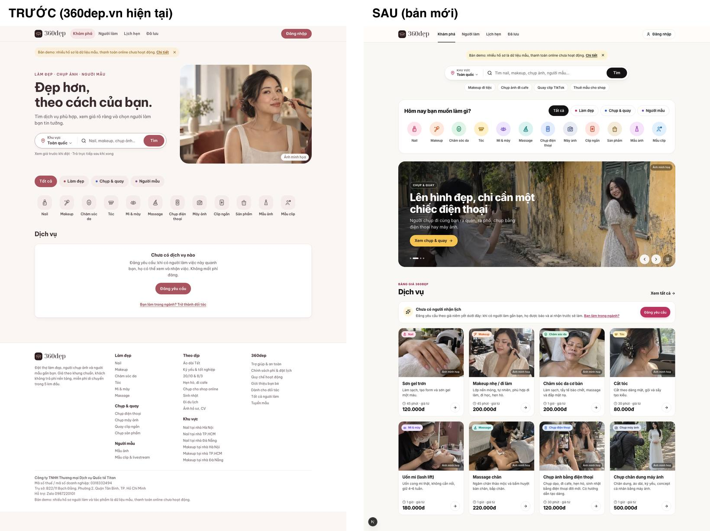

# Giao diện "giấy sáng, chữ đậm" — 12/10/2026

Tham chiếu: toilanguoisaigon.com (nền giấy kem, chữ gần đen, Inter + Fraunces, ô danh mục tròn màu pastel, hero ảnh lớn có nút vàng, nhãn eyebrow nhỏ in hoa, footer tối).

## Audit bản cũ

| Vấn đề | Nguyên nhân |
| --- | --- |
| Chữ khó đọc | Chữ nâu `#3A2A2C` và xám-nâu `#736366` trên nền hồng `#FAF6F4`; hơn 600 chỗ dùng `text-muted`/`text-ink-soft` |
| Thiếu hiện đại | Một màu hồng đất cho mọi thứ (nút, tab, chip, ô danh mục) nên không có thứ bậc; hồng trên hồng |
| Icon nhỏ, nhạt | Icon nét mảnh trong ô vuông hồng nhạt, 12 danh mục cùng một màu |
| Trang chủ trống | Production 0 đối tác → nội dung chính là hộp "Chưa có dịch vụ nào" |
| Bộ lọc chồng chéo | `/pros` có 3 tầng chọn (Nail/Makeup/Khác → ngành → lưới 12 ô) trước khi thấy người |

## Đã làm

- **Token** (`lib/design/tokens.ts`, `app/globals.css`, dùng chung web + app): nền `#FAF8F5`, chữ `#141213`, chữ phụ `#3D3739`/`#655E60`, son hồng `#BB3460` cho hành động, vàng champagne `#F6C453` cho lời mời. Mọi màu chữ đạt AA trên canvas/surface/subtle.
- **Màu riêng từng danh mục** (`CATEGORY_TINTS` trong `lib/design/category-icons.ts`): đĩa pastel + icon đậm, dùng ở web và app.
- **Font**: Inter (UI) + Fraunces (tiêu đề biên tập), cả hai có bộ ký tự tiếng Việt. App mobile chuyển sang Inter.
- **Trạng thái "đang chọn"** chuyển sang mực đen (chip, tab, segmented, viền chọn); hồng chỉ còn cho nút hành động.
- **Trang chủ** dựng lại: thanh tìm kiếm + gợi ý theo lịch, thẻ "Hôm nay bạn muốn làm gì?", hero carousel (3 ngành + dịp đang mùa), bảng giá niêm yết của 360đẹp khi chưa có người nhận (giá thật từ `lib/catalog.ts`, dẫn tới `/dich-vu/[id]`), "Theo dịp", "Cách 360đẹp làm việc", khối đăng yêu cầu.
- **Header** gạch chân mực cho mục đang ở; **footer** nền tối; **tab bar** mobile chữ đậm mực.
- `/dich-vu/[id]` có ảnh lớn + tag danh mục, khung giá mở sẵn khi chưa có người nhận; `/doi-tac` có hero tối + nút vàng, lưới bước, danh mục dạng chip màu; `/pros` gom bộ lọc vào một thẻ.
- **Ảnh**: 8 ảnh mới cho Chụp & quay / Người mẫu / hero (`public/images/catalog`), tạo bằng Codex image gen, cùng phong cách "khách tự chụp" với ảnh cũ. Mọi chỗ dùng ảnh minh hoạ đều ghi "Ảnh minh hoạ" (`lib/design/photos.ts`).

## Kiểm tra

`npm test` 263 pass; `npm run lint` sạch; `tsc` web + mobile sạch; `next build` 84 route. Đã xem trên Chrome ở 375px và 1440px (đọc dữ liệu production); không có tràn ngang ở 375px.

